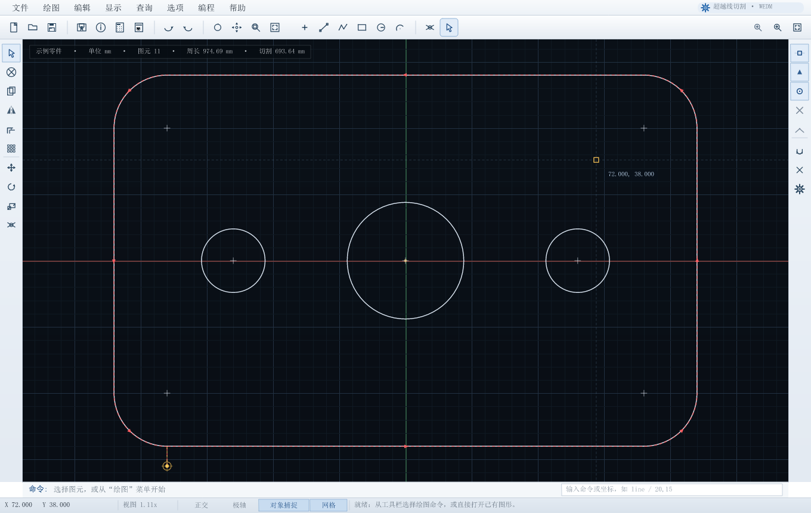
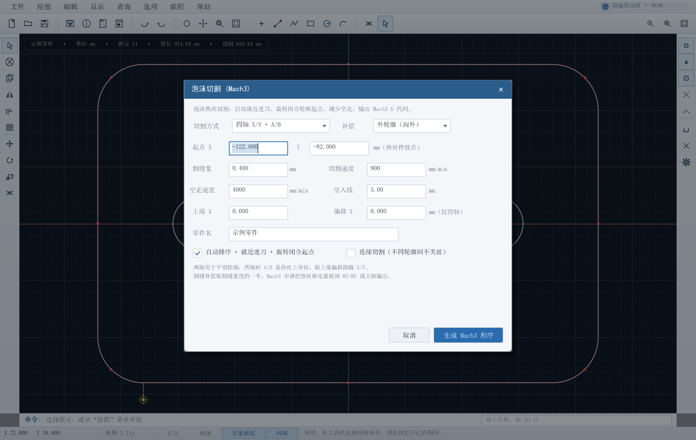

# 超越数控线切割编程系统

面向 **快走丝 / 中走丝线切割** 和 **热丝泡沫切割** 的 Windows 桌面绘图与编程软件。使用 Rust + Win32 重新制作，启动快、无需安装，界面沿用经典线切割编程软件的工作方式。



## 下载与运行

- **直接运行**：下载 [`dist/chaoyue-cnc.exe`](dist/chaoyue-cnc.exe)，双击即可。也可以在 [GitHub Releases](https://github.com/kwiza-kh/chaoyue-cnc/releases/latest) 下载打包好的 zip。
- **系统要求**：Windows 10 / 11（64 位），无需 .NET、Java 或其它运行库。
- **首次使用**：建议先看 [使用说明](docs/使用说明.md)；泡沫切割和 Mach3 的机床设置见 [Mach3 设置说明](docs/MACH3-设置.md)。
- **安全提示**：程序生成的是机床代码，第一次上机请务必 **空走 / 单段 / 断开热丝或钼丝** 验证方向、单位、补偿和 M3/M5 继电器，确认无误后再正式加工。

## 主要功能

### 绘图与编辑
- 点、直线、多段线、矩形、圆、圆弧；端点 / 中点 / 圆心 / 交点 / 最近点捕捉。
- 选择、框选、移动、复制、镜像、旋转、缩放、偏移、矩形阵列、修剪、删除。
- 撤销 / 重做（60 步）、正交 / 极轴 / 网格、滚轮缩放、中键平移、窗口缩放、显示全部。
- 命令栏支持 **命令名 / 别名**（例如 `line`、`直线`、`foam`），输入 `?` 查看命令表；原有的坐标输入（如 `20,15`）保持不变。
- 距离 / 面积 / 周长查询，图形辅助信息，DXF 导入，打印预览。
- 图形保存为 `.cnc` 文本文件，可直接备份、拷贝。

### 大图纸性能
- 拾取、悬停、对象捕捉、交点捕捉、框选都走**空间网格**局部查询，不再每次鼠标移动扫描整张图。
- 平移时复用上一帧合成画面；拖动选中图元时使用“挖掉选择”的缓存层，只重画正在移动的图元。
- 静态图形层的缓存键改为文档修订号，不再每帧遍历、哈希全部图元。
- 本机 release 基准（`--bench-large`，20 000 个图元）：
  - 悬停 + 捕捉：约 **0.003 ms/次**（原约 0.95 ms/次）。
  - 中键平移：约 **2.1 ms/帧**；拖动选中图元：约 **2.0 ms/帧**（原约 100 ms/帧）。
  - 放大到局部后改变视图：约 **28 ms/帧**；整屏显示全部 20 000 个图元时仍受 CPU 光栅化限制，约 100 ms/帧。复杂零件建议放大到加工区域操作。

### 线切割编程
- 按选中图元（未选择时按全部图元）自动串接轮廓、按补偿方向生成切割路径。
- 穿丝孔、左 / 右 / 不补偿、路径长度统计、切割面积 / 工时 / 金额估算。
- **3B 代码**、**ISO G 代码**、**Mach3 G 代码** 三种输出，可校验、显示、存盘。
- 代码传送窗口目前为演示（未连接真实控制器），实际联机需要按机床控制器协议另做适配。

### 泡沫切割（Mach3）


- 两轴 **X/Y** 平切，或四轴 **X/Y + A/B**（A/B 为热丝上导向）。
- 自动就近进刀、闭合轮廓起点旋转、空走路径缩短；程序会比较“原顺序 / 仅排序 / 排序 + 旋转起点”三种方案，选空走最短的。
- 割缝补偿（按割缝宽度的一半偏移）、引入线、切割速度、空走速度。
- 可选择 **连续切割**（不同轮廓之间不关丝）或 **关丝空走**。
- 输出 Mach3 `.tap` 程序：`G21 G90 G94 G17 G40 G49 G80`、`G91.1`、`M3/M5` 热丝开关、`G4 P0.3` 起弧等待、`M30` 结束。
- 四轴模式每个动作同时输出 A/B 上端坐标；上端偏移可在对话框中设置。

### 界面流畅度
- 背景网格、静态图形层、文字和图标都做了位图缓存，鼠标移动时只重绘选中 / 悬停 / 十字光标等变化部分。
- 选项、设置、代码页使用独立的暗化背景缓存和局部刷新。
- GDI 位图缓冲常驻复用，不再每帧创建 DIB。
- 本机 release 基准（含窗口呈现）：示例零件约 **1.7 ms/帧（580+ fps）**；实际显示受 Windows 消息和屏幕刷新限制。
- 调试构建的基准明显更慢；请以 release 程序为准。

## 快速开始

1. 双击 `chaoyue-cnc.exe`。
2. 从工具栏选择 **矩形 / 圆 / 多段线** 画出零件轮廓。画封闭轮廓时首尾点要重合或使用捕捉。
3. 框选轮廓（或直接不选，按全部图元生成）。
4. 线切割：菜单 **编程 → 切割编程...**；泡沫切割：**编程 → 泡沫切割 (Mach3)...**（快捷键 F5）。
5. 设置穿丝孔 / 起点、补偿、速度等参数，点 **生成**。
6. 在代码窗口点 **校验**，确认后点 **存盘**。泡沫切割默认扩展名为 `.tap`。
7. 把程序拷到 Mach3 或控制器，先空走验证。

更详细的分步说明：[docs/使用说明.md](docs/使用说明.md)。

## 构建

需要 Rust 工具链（本仓库使用 Rust 1.96，Windows x64）和已缓存的依赖：

```powershell
cd app
cargo build --release --offline
```

生成文件：`app/target/release/chaoyue-cnc.exe`。

依赖只有 `tiny-skia`、`ttf-parser` 和 `windows-sys`，全部通过 Cargo 获取，运行时不联网。

### 自检命令

```powershell
# 几何 / 3B / G 代码 / Mach3 / 泡沫 / DXF / 存取盘自检
.\target\release\chaoyue-cnc.exe --selftest

# 菜单、对话框、绘图、编辑、泡沫 Mach3 生成等 UI 交互测试
.\target\release\chaoyue-cnc.exe --uitest

# 渲染 + 窗口呈现基准
.\target\release\chaoyue-cnc.exe --bench

# 大图纸交互 / 平移 / 拖动 / 局部重绘基准（默认 20 000 个图元）
.\target\release\chaoyue-cnc.exe --bench-large 20000

# 生成界面截图
.\target\release\chaoyue-cnc.exe --screenshot shots\main.png
.\target\release\chaoyue-cnc.exe --demo-dialog foam --screenshot shots\foam.png
```

单元测试（空间索引、命令表）：

```powershell
cd app
cargo test --release
```

## 目录结构

```
app/                 Rust 源码（主程序、几何、代码生成、泡沫模块、绘图工具包）
  src/app.rs         界面、工具、对话框、交互、图层缓存
  src/codegen.rs     轮廓串接、补偿、优化、3B / ISO / Mach3 线切割代码
  src/foam.rs        泡沫切割路径优化与 Mach3 两轴 / 四轴代码
  src/model.rs       几何模型、文档修订号、空间查询
  src/spatial.rs     均匀网格空间索引（拾取 / 捕捉 / 框选 / 视口裁剪）
  src/commands.rs    命令表（命令栏名称、别名、动作映射）
  src/gfx.rs         软件绘图、文字 / 图标缓存
  src/dxf.rs         DXF 导入
  src/platform.rs    Win32 窗口、GDI 呈现、文件对话框
docs/                截图、使用说明、架构与扩展说明
dist/                可直接运行的 exe 和启动脚本
```

扩展开发（新增命令、修改几何缓存规则、空间索引约定）见 [docs/架构与扩展.md](docs/架构与扩展.md)。

## 已知限制

- 没有连接真实机床控制器；传送窗口是演示。
- 没有使用原厂的加密狗 / 旧 `.ang`、`.crs`、`.aa`、`.dat` 文件格式；使用本软件的 `.cnc` 文本格式和通用 DXF。
- 3B 的 `J`、`GX/GY`、`NR/SR` 象限约定是按常见格式重建的，第一次上机必须单段核对。
- 四轴泡沫切割目前是 **恒定上端偏移** 的锥度 / 斜切；如果要做上下轮廓完全不同（例如翼型），需要再扩展。
- 原程序的齿轮 / 花键 / 方程曲线、AutoCut、3D 显示、真实打印机输出未包含。
- 原程序在 Windows 11 上无法正常启动，因此界面是按窗体资源和语言表重建的，不是逐像素复刻。

## 版本

当前版本 **1.2.0**。变更记录见 [CHANGELOG.md](CHANGELOG.md)。

## 许可

MIT License，详见 [LICENSE](LICENSE)。
